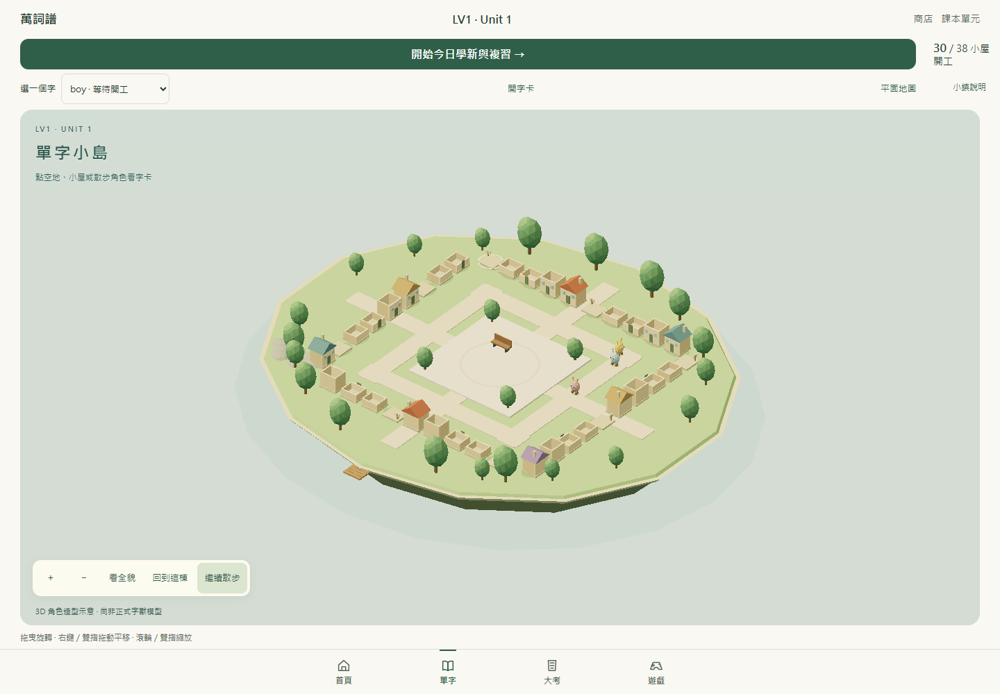
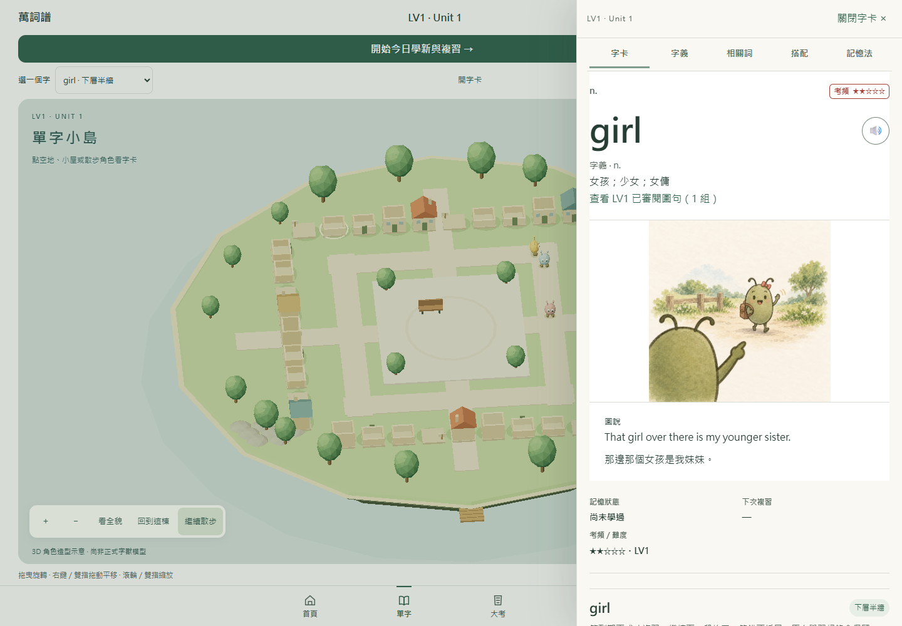
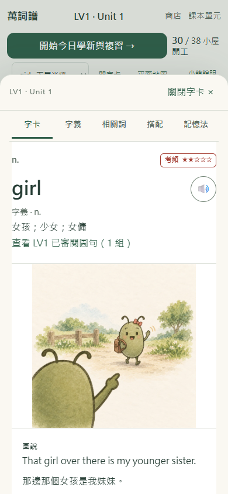

# LV1 Unit 1：3D 小鎮示範

基底為 `main` 的 `5774b085fffd50e5028a53e58c92c3940653f76f`（PR56）。範圍只限 LV1 Unit 1，未合併、部署或改寫教材與母表。

## 操作與素材

- `#/town/LV1/1` 預設開啟真正的 Three.js / WebGL 2 場景：38 塊地、一字一屋、四面住宅、中央廣場與海岸。拖曳旋轉，右鍵或雙指平移，滾輪或雙指縮放。
- 點地塊、小屋或散步角色，從右側開啟原有字卡。手機為底部抽屜，沿用字卡、字義、相關詞、搭配、記憶法五頁；缺資料的頁面明示尚未收錄。相關詞也能在抽屜內開啟。
- 關閉或 Escape 保留鏡頭；字卡使用原生 modal dialog 管理焦點。單字目錄與「開字卡」提供鍵盤入口。
- 上方學習入口直接接原日課，不需要先操作 3D。平面地圖可手動切換；WebGL 不支援、建立失敗或 context lost 時保留原地圖與學習入口，可重試 3D。
- 沿用現有四階成長、舊版小屋保留、排程、題量設定、續答、獎勵去重及裝飾所有權／位置。LV4 Unit 17 保持原地圖；未改資料庫 schema、教材 JSON、SRS 或獎勵程式。

目前版本庫沒有 `.glb`、`.gltf`、`.obj`、`.fbx` 字獸模型。三隻散步角色是原創程序化立體造型示意，畫面持續標示「尚非正式字獸模型」，不代表收服紀錄，也不宣稱與既有插畫相同。道路、建築、植栽及角色均由幾何程式產生，沒有複製外部素材。

[使用者的參考網站](https://research-navigator-nu.vercel.app/learning-map/index.html#RN) 僅用來確認低多邊形小島、走動與側欄的方向。下一個美術決策是正式字獸的 3D 造型與行走動畫；本示範不自動核准該造型，也不擴至其他單元。

## 畫面

下圖全部使用隔離瀏覽器的合成進度。新玩家仍從空地開始，示意房屋不是預送的學習成果。







## 本機驗證（2026-11-03）

- `npm run lint`、`npm run typecheck`、`npm run build`、`git diff --check` 通過。
- 完整 App 套件：206 檔、1,643 項；1,642 項通過，既有 `lv1Unit16Text.test.ts` 的內容更新保留測試在 15 秒門檻超時。整套結束後，以相同 15 秒門檻獨立重跑該檔，11／11 通過，未改測試門檻或該檔內容。
- 服務端 20 項、Python LV3 14 項／LV4 7 項／LV5 10 項，以及 recovered drafts／units 的 `--check` 通過。
- Chromium 實際 WebGL 2：走動／暫停、直接點 3D 地塊、五頁、原生焦點限制、Escape、鏡頭不變、減少動態效果、390×844／320×740／736×414 無橫向溢出、雙指縮放不誤開字卡均通過。
- 全新非持久瀏覽器先核對 14 表全空，才預植合成資料。讀卡、尺寸切換、離線重整、WebGL 中斷／重試及造訪其他單元前後，14 張非空表逐列相同，包含 73 筆合成複習紀錄、60 金幣、兩個城鎮的裝飾及其他會話哨兵。
- 實際快速學習一題：新增一筆紀錄與 5 金幣；回鎮自動定位、續答與重整保持同一輪／選項，沒有重複保存或發幣，其他會話與裝飾表不變。

完整輸出和額外尺寸／離線／備援截圖保留於本機 `output/playwright/` 及 `*-tests.log`，不將測試資料當成正式玩家資料。

## 重現

```sh
npm ci
npm test -- --maxWorkers=1 --testTimeout=15000
npm run lint
npm run typecheck
npm run build
npm run preview -- --host 127.0.0.1 --port 5175 --strictPort
```

使用 Playwright CLI 建立**新的非持久**瀏覽器、只允許 localhost，再依序執行 `scripts/qa/town-3d-seed.playwright.txt`、`town-3d-verify.playwright.txt`。種資料腳本同時限制來源為 `http://127.0.0.1:5175`，且 14 張進度表只要任何一張非空就拒絕執行。`town-3d-study.playwright.txt` 供合成資料上的第一題正常日課驗證，不可對真實使用者資料執行。

## 資源與未驗範圍

3D 引擎獨立延遲載入（約 599 KB，gzip 約 152 KB），沒有外部模型或貼圖下載。低耗電 renderer、DPR 上限 1.35、最多 30 fps；暫停、讀卡、背景分頁或系統偏好減少動態時停止持續動畫，離開地圖會釋放 WebGL 資源。引擎 chunk 沿用現有 PWA 預快取。

本機 Node 24.3.0，測試單 worker，Node heap 上限 2 GB；主機實體記憶體為 16 GB，**未在實體 8 GB 電腦量測幀率**。未測實體手機、Safari／Firefox、OS 安裝 PWA 捷徑與完整跨版本冷啟動離線矩陣；不宣稱所有裝置可達 30 fps。
