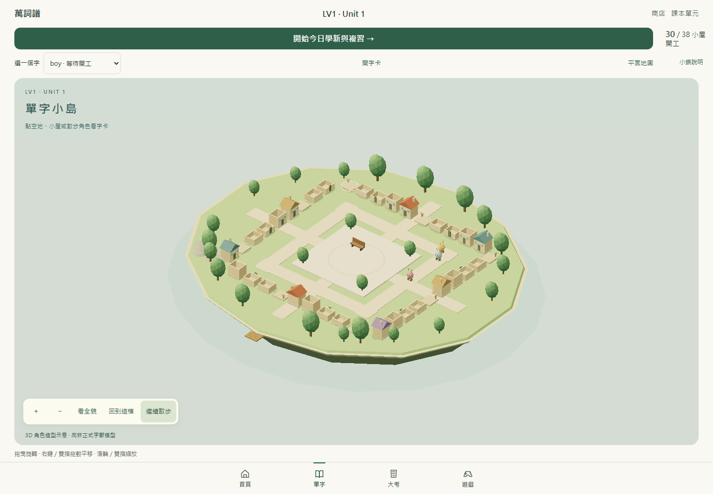
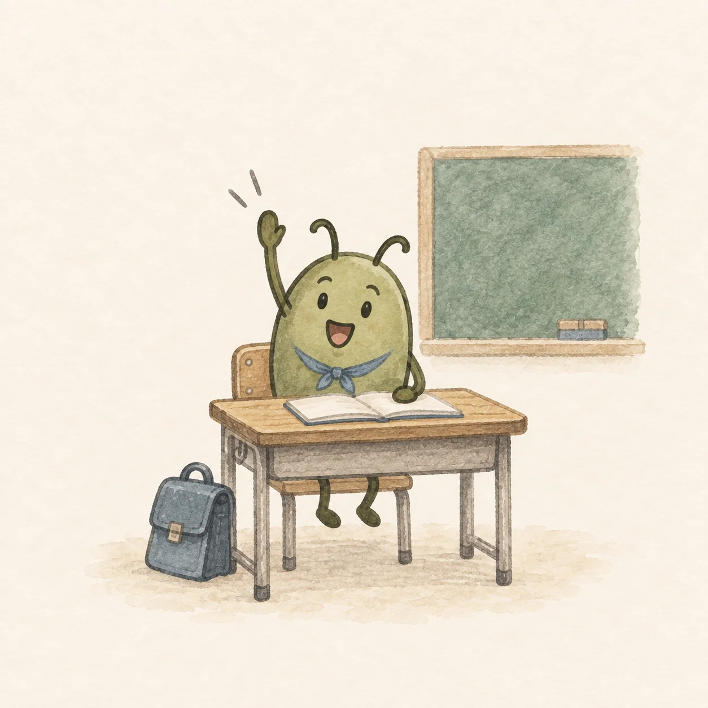
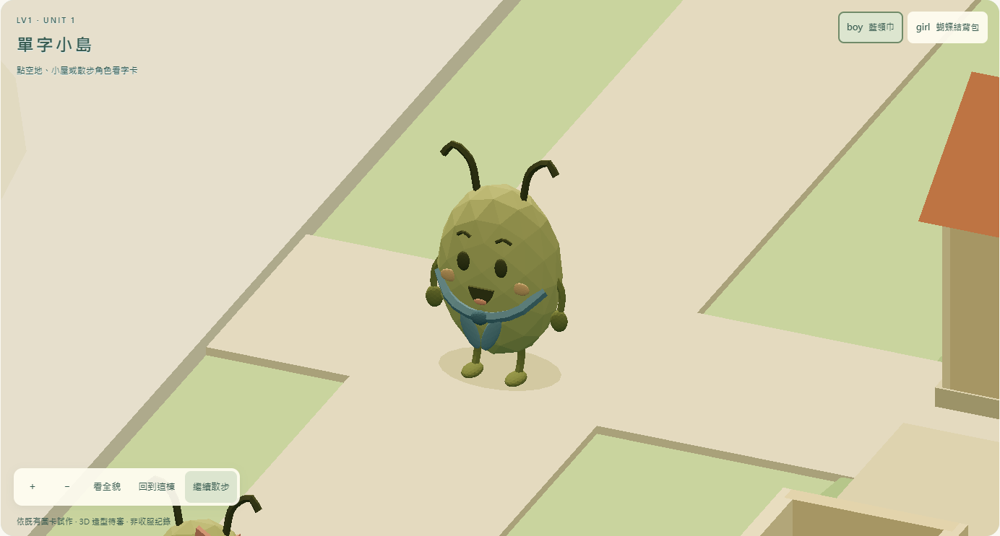
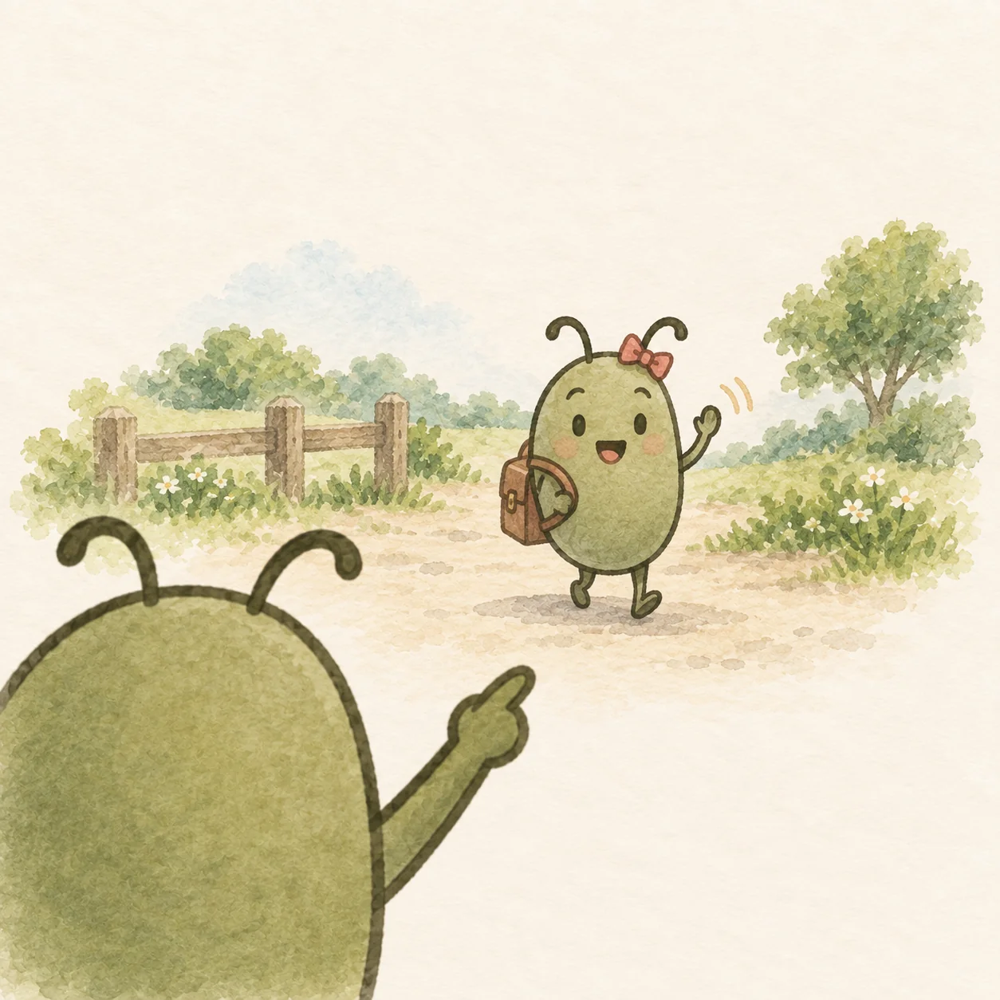
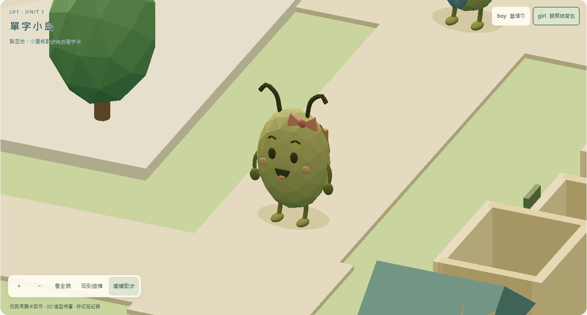
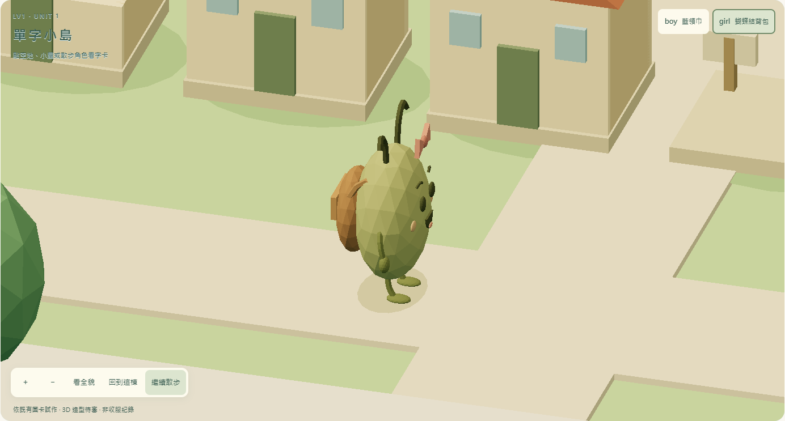
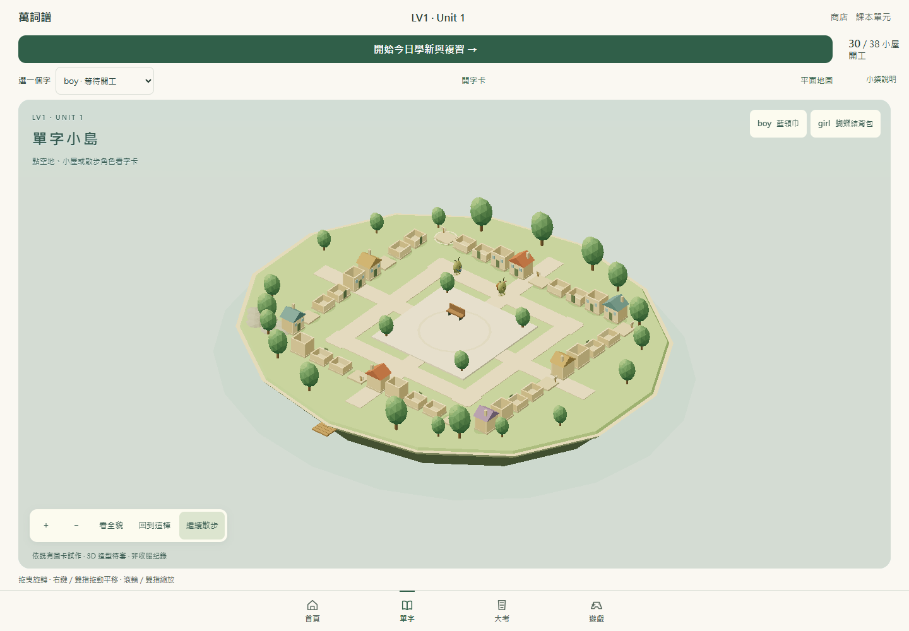
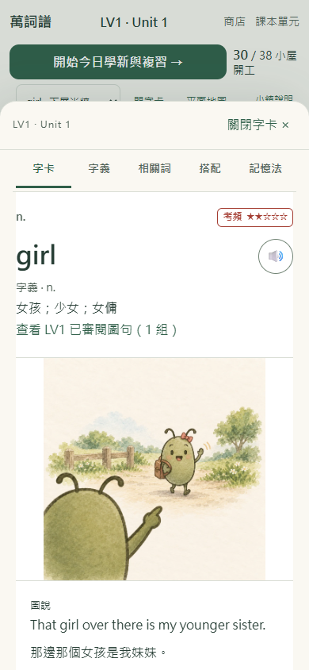
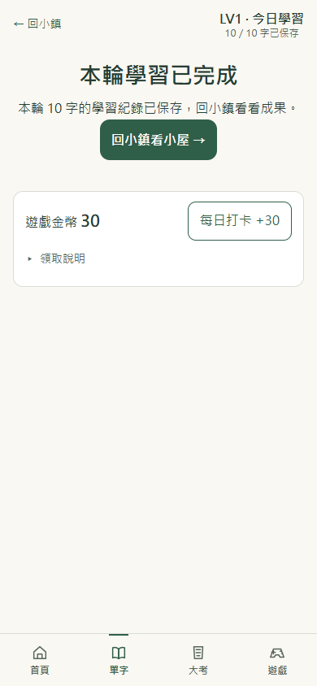
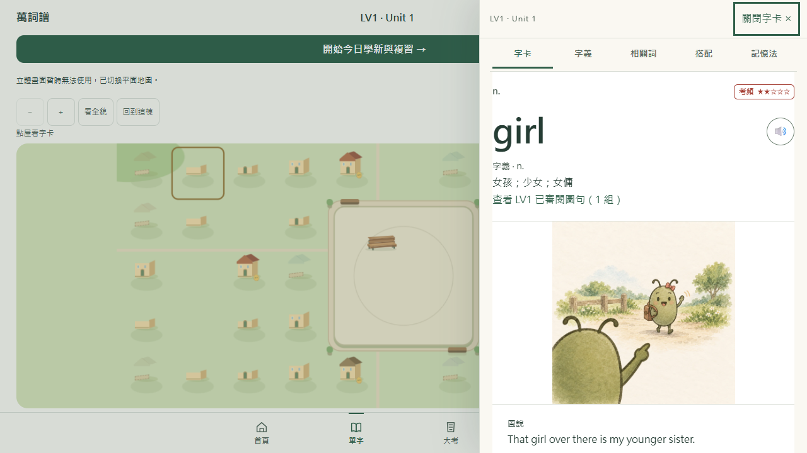

# LV1 Unit 1 圖卡角色立體試作（待審）

本輪沿用 PR57 的同一個小鎮，不新增其他單元、不修改原圖、教材、SRS 或進度 schema。

## 身分與可用素材

`docs/LV1-reviewed-images-20260920.md` 記錄使用者允許已核准圖句發布，Unit 1 共 38 組。App 的 `lv1ReviewedImages.json` 與 `approvedCurriculum.ts` 對應這批公開素材。本次使用既有圖作造型參考，所有 3D 表面、配件及步態均為原創程序化幾何，沒有外部模型或直接烘焙圖片。

這些是例句情境圖；同一豆形角色在不同情境換配件，資料沒有為每個單字定義獨立物種／正式 3D 身分。因此本版稱為「圖卡角色試作」，不代表正式字獸設計或收服紀錄。原圖發布核准不自動成為新 3D 造型的美術核准。

| 試作 | 教材圖卡／正式詞條 | 取用的可見識別 | 未推定內容 |
| --- | --- | --- | --- |
| boy | LV1-U01-01／W000114 | 綠色橢圓豆形、彎觸角、深色橢圓眼、藍領巾 | 沒有宣稱是 boy 專屬物種，也未重製課堂場景 |
| girl | LV1-U01-02／W000347 | 同一類豆形、粉色蝴蝶結、棕色背包 | 沒有新增角色名字、故事或正式收服規則 |

`man` 的 LV1-U01-03 教的是「負責服務台」的動詞義，原圖也有兩個情境角色，不能由單字拼字自行指定「男性字獸」。本輪移除原本依陣列前三項任意綁定的三色示範角色，只在圖卡 ID、正式詞條 ID 與拼字三者一致時顯示以上兩隻試作。

## 供審閱的方向

**A：先前泛用暫製造型**（PR57 初版），只驗證走動與點選，不對應既有插畫。

**B：依現有圖卡的豆形與配件製作**（本輪候選），可用畫面右上角的 boy／girl 按鈕近看；近看會暫停散步並選中對應單字，按「開字卡」或點角色即可閱讀。

| 既有核准情境圖 | B：原創 3D 試作，尚待審閱 |
| --- | --- |
|  |  |
|  |  |

待使用者裁示：是否以 **B 的綠豆身形＋既有配件**作為後續少量 3D 美術的基礎，或維持 **A 的泛用占位角色**、等正式模型再接。本版 B 只作試看，畫面持續標示「3D 造型待審」，不把「可以繼續」解讀為正式美術核准。

## 操作改善

- 角色的點選目標比可見身體稍大，彎觸角與步行中的四肢不會使觸控命中忽有忽無。
- 臉、蝴蝶結、背包與身體共用上半身步態，避免只有身體上下動、眼睛與配件留在原位。
- 房屋階段更新不重建同一組角色；動畫本身不新增幾何。兩隻合計少於 18,000 三角面、90 個 mesh，沿用低耗電、DPR 1.35 與 30 fps 上限，不下載模型或貼圖。
- 修正手機在 `pointerup` 開卡後，隨後的相容性 `click` 擊中入場背景而立即關卡的問題。現在保留有效單指點選，等完整 `click` 才開卡；拖曳、雙指與取消手勢仍不開卡。
- 原有鍵盤目錄、完整五分頁、關閉鏡頭保留、快速學習、平面地圖與 WebGL 備援保留。

## 驗證與實機限制

`npm run lint`、`npm run typecheck`、`npm run build`、`git diff --check` 通過。完整 App 測試使用原本 15 秒門檻與單 worker，207 檔、1,645 項一次全過（約 23 分鐘，沒有重跑或放寬門檻）。服務端 20 項、Python LV3 14 項／LV4 7 項／LV5 10 項及兩個 recovered `--check` 全部通過。

本輪最終 build 的三組瀏覽器腳本均通過：

- 兩隻角色：鍵盤近看、點 3D 角色開正確字卡、五分頁、關閉保留鏡頭；390×844 原生觸控模擬不再立即關卡。離線重載後仍可讀角色及已看過的插畫。
- 14 張非空合成進度表逐列不變，包括 73 筆複習紀錄、60 金幣、兩鎮裝飾與其他會話；WebGL renderer 建立失敗及 context loss 均自動轉平面，鍵盤讀卡可用，重試 3D 成功，其他單元保持原地圖。
- 正常十題整輪在另一個全新非持久手機情境執行，答對／答錯各五題，回鎮後續答與重載保留選項，第七題起離線完成。雙次確認只寫一筆：共 10 筆紀錄、10 筆答題獎勵、30 金幣；完成畫面重載無額外寫入。回鎮為 5 棟下層半牆、33 塊空地，沒有預送成果。
- 走動／暫停、減少動態、直接點屋、雙指縮放不誤開卡、320×740／390×844／736×414 無橫向溢出均通過。

可重用腳本：`scripts/qa/town-resident-verify.playwright.txt`（兩角色、鍵盤、原生觸控、離線及建立 WebGL 失敗備援），`town-full-round.playwright.txt`（全新隔離手機情境的十題整輪、中斷重載、離線完成與去重），及初版 `town-3d-verify.playwright.txt`。全部只對 localhost 的非持久合成測試資料操作。

三組腳本的結構化結果保存在 [browser-acceptance.json](town-3d/browser-acceptance.json)。執行期間勿重建／更換 preview 的 dist；跨版本更新屬下列未驗矩陣。

本機 ADB 盤點未連接可用 Android 設備；沒有取得實體手機驗收。手機結果為 Chromium 觸控模擬，未宣稱 iOS、Safari／Firefox、實體 8 GB 電腦或完整 OS 安裝 PWA 冷啟動矩陣通過。主機實體 16 GB，驗證維持單個測試 worker、Node heap 2 GB 上限。
